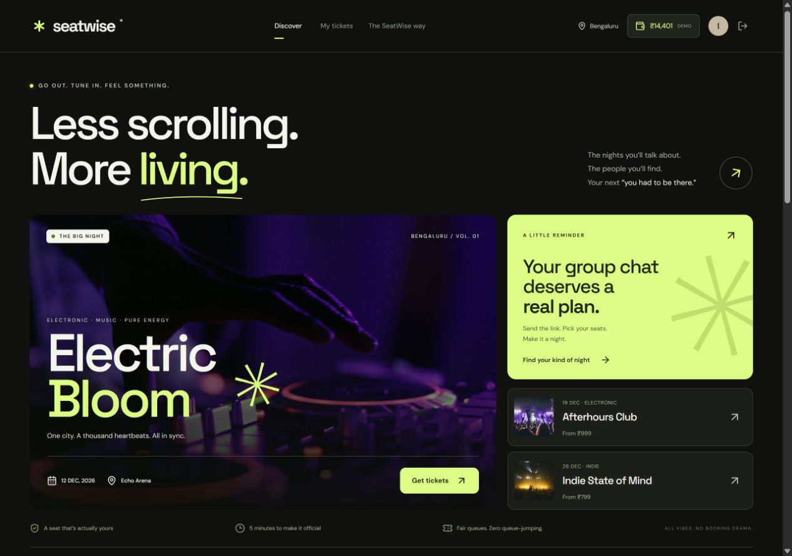
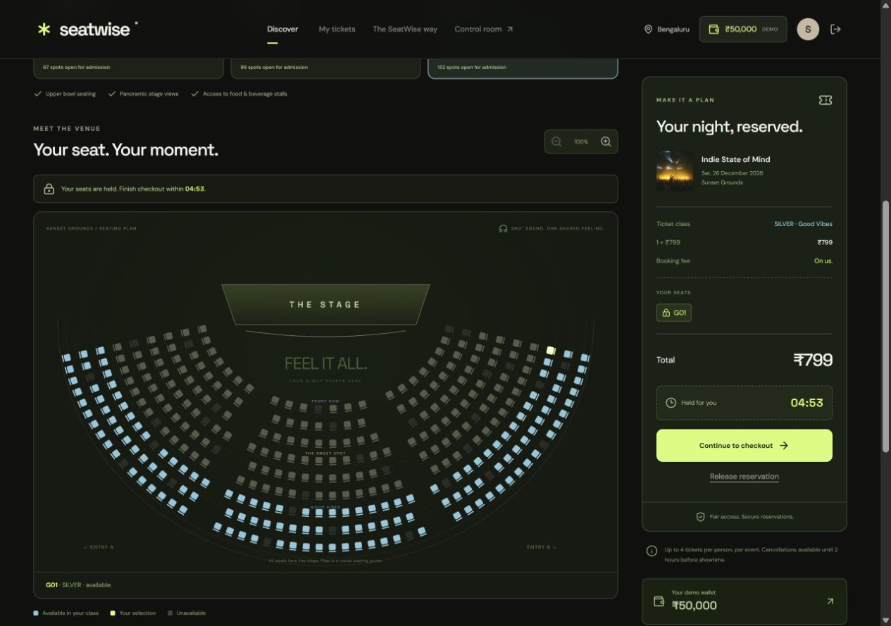
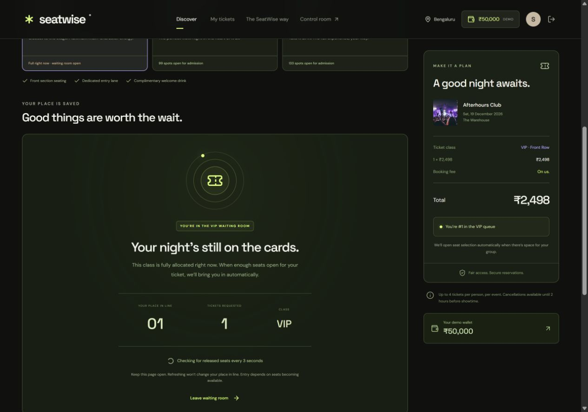
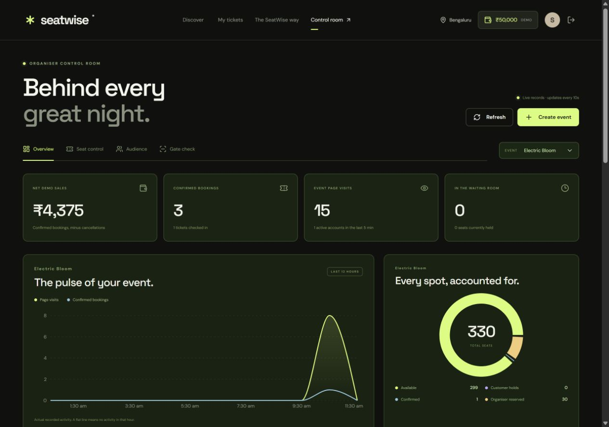
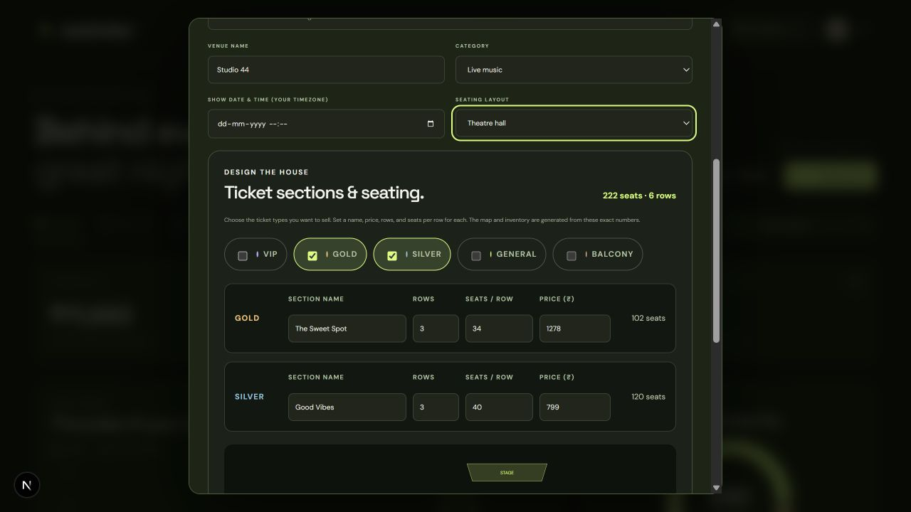
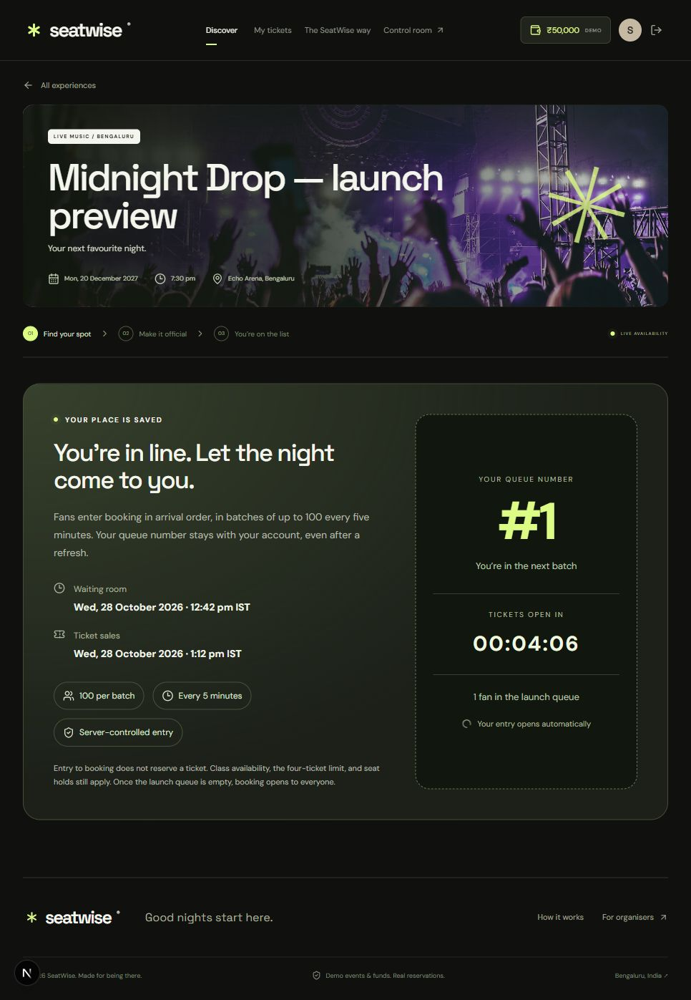

# SeatWise

### Good nights start here. Fair booking makes them possible.

[**Open the live demo →**](https://seatwise-gamma.vercel.app) · [Booking rules](#booking-rules) · [Run locally](#run-locally) · [Tests](#tests)

A full-stack concert and live-show ticketing platform with class-specific waiting rooms, atomic seat reservations, wallet checkout, and single-use QR entry. Built to demonstrate what happens when multiple fans try to book the same limited inventory.

> **Demo money, real state transitions.** Events and funds are simulated; accounts, queues, seat holds, payments, refunds, and gate scans are stored in hosted PostgreSQL. Local development currently shares the live database.



## Explore the product

| For fans | For organisers |
| --- | --- |
| Discover concerts, comedy, theatre, and live music | Publish events with a choice of six banner templates |
| Choose VIP, Gold, or Silver and request 1–4 tickets | Monitor signups, traffic, sales, queues, and check-ins |
| Enter a class-specific FIFO queue when capacity is full | Reserve seats for guest lists and release allocations |
| Select seats manually or lock a random auto-pick | Inspect occupancy and traffic graphs for each event |
| Complete mock wallet checkout and retrieve QR tickets | Verify QR codes by camera, image upload, or pasted code |
| Cancel eligible bookings for a wallet refund | Review suspicious booking patterns with clear reasons |

## Screens and walkthrough

<details open>
<summary><strong>Interactive stadium and seat holds</strong></summary>



Choose a class, enter booking, and click a seat. A five-minute server-side hold begins on the first selection. Another account sees that seat as unavailable. Auto-pick claims random available seats in the chosen class and locks the selection for checkout.
</details>

<details>
<summary><strong>Class-specific waiting room</strong></summary>



Full VIP inventory sends VIP buyers into its own queue. Other classes can still admit customers. Releasing enough capacity promotes the oldest eligible request in that class. Refreshing preserves queue position and never extends admission or hold deadlines.
</details>

<details>
<summary><strong>Organiser analytics and seat control</strong></summary>



Select an event to inspect its traffic and occupancy. Counts reconcile available, held, booked, and organiser-reserved seats. Sales and activity come from recorded application actions; screenshots are illustrative snapshots, not current totals.
</details>

## A presentation using all six shows

| Show | Demonstration | What the audience should observe |
| --- | --- | --- |
| Electric Bloom | Complete successful booking | Wallet decreases once; booking and QR tickets appear |
| Afterhours Club | VIP queue versus available Gold/Silver | Availability and admission are specific to the requested class |
| Indie State of Mind | Two accounts compete for one seat | Exactly one account obtains the hold |
| The Laugh Track | Sold-out event and admin release | Waiting fan is admitted after enough reserved capacity is released |
| Velvet Nights | Auto-pick | Random seats are held together and cannot be manually changed |
| Beyond the Script | Failed payment, retry, cancellation | Failure deducts nothing; successful cancellation refunds once |

These are suggested scenarios. **All six events use the same engine.** Sold-out and full-class conditions describe the initial seed and may change as people use the demo. Prepare allocations in **Admin → Seat control** before presenting. Use separate accounts/browser profiles for concurrency; two tabs on the same account share one active session.

### Suggested 5-minute demo

1. Sign in with a fresh demo account and point out its randomly assigned wallet.
2. Book one Electric Bloom seat and show that another account cannot claim it.
3. Finish checkout; open **My tickets** and save the QR.
4. Show Afterhours VIP waiting while another class can admit buyers.
5. In the admin browser, release capacity for a waiting request.
6. Upload the confirmed QR in **Gate check**; repeat it to show rejection.
7. Finish with event graphs and the booking activity trail.

### Create an event with a banner

The event editor also lets organisers design the venue: pick an arena bowl, stadium grandstand, theatre hall, or outdoor amphitheatre; choose any combination of VIP, Gold, Silver, General, and Balcony; and set each section's display name, row count, seats per row, and price. The live preview shows the generated capacity and seating shape. A venue can have one to five sections and up to nine rows in total, with 8–40 seats per row. For example, a Gold section with 2 rows of 10 seats at ₹1,400 plus a Silver section with 1 row of 12 seats at ₹600 creates 32 bookable seats and no VIP tickets. Section inventory, prices, admission queues, and the organiser dashboard all use those saved choices. Existing published events keep their original seat maps.



Open **Admin → Create event**, choose **Event banner template**, and review the image preview with your event title. Enter the venue, category, show date, section prices, and description, then publish. The selected image is saved with the event and used on discovery cards, the event banner, booking summaries, and tickets.

The six built-in themes are Electric Bloom, Afterhours, Indie, Comedy, Velvet, and Theatre. Templates reuse bundled images; arbitrary uploads and external image URLs are not part of this feature. Add another template in **lib/banners.js** and put its image under **public/images/**. The server validates template IDs against that shared list.

## Architecture at a glance

~~~mermaid
flowchart LR
    Fan[Fan browser] --> API[Next.js API on Vercel]
    Admin[Organiser browser] --> API
    API --> Auth[Sessions and ownership checks]
    API --> Engine[Admission / hold / payment engine]
    Engine --> DB[(Hosted PostgreSQL)]
    Auth --> DB
    API --> QR[Signed QR and atomic check-in]
    QR --> DB
~~~

~~~mermaid
stateDiagram-v2
    Available --> Held: Admitted fan selects a seat
    Held --> Booked: Successful payment before expiry
    Held --> Available: Expiry / release / payment failure
    Booked --> Available: Eligible cancellation and refund
    Available --> Reserved: Organiser allocation
    Reserved --> Available: Organiser release
~~~

A queue admission promises capacity in one class; it does not assign a physical seat. A hold assigns specific seats. A successful payment converts those held inventory rows into a confirmed booking. The database enforces the transitions across Vercel instances.

## Technology

| Layer | Implementation |
| --- | --- |
| Interface | React, Next.js App Router, custom responsive CSS, Lucide icons |
| Charts | Recharts; recorded activity with India-time labels |
| API | Next.js Node route handlers; validation and role checks on the server |
| Database | PostgreSQL on Neon; SQL schema and parameterised queries |
| Connection lifecycle | pg pool, verified TLS, Vercel attachDatabasePool, bounded timeouts |
| Authentication | scrypt password hashes; opaque HttpOnly cookie sessions |
| Tickets | Server-signed QR tokens; qrcode generation and jsQR image decoding |
| Deployment | Vercel, with API and database configured near Singapore |

## Repository map

~~~text
app/                 Pages, API route, global styling
components/          Discovery, booking, account, tickets, wallet, admin UI
lib/banners.js       Shared banner-template allowlist
lib/catalog.js       Initial six events, classes, and stadium geometry
lib/schema.sql       Database tables, constraints, and indexes
lib/db.js            Inventory transaction and queue invariants
lib/sql.js           Parameterised SQL tag and Vercel-compatible pg pool
lib/service.js       Authentication, booking, wallet, gate, and admin API
scripts/             Additive database setup and live smoke verification
tests/               Shared-database integration suite
public/images/       Bundled banner photography
docs/images/         Demonstration screenshots for this README
~~~

## Run locally

Requires Node.js 22 or newer.

```powershell
npm install
```

Copy `.env.example` to `.env.local` and fill in a PostgreSQL connection string, a long random `SESSION_SECRET`, and unique organiser credentials. The already configured workspace has its environment set up. Keep `.env.local` private.

```powershell
npm run db:setup
npm run dev
```

Open `http://localhost:3000`. For a production build, use `npm run build` followed by `npm start`.

## Accounts and demo wallets

- **New user:** Sign up with a name, email, and password. A random ₹9,000–₹18,000 demo balance is credited once.
- **Quick demo:** “Try a fresh demo account” creates a separate account and wallet for the current browser. These guest accounts are meant for the current session; create a normal account to sign in again later.
- **Organiser:** Use the credentials in the local, ignored `DEMO_CREDENTIALS.md`. The file and environment secrets are excluded from Git and Vercel uploads. Open `/admin` after signing in.
- Passwords are salted and scrypt-hashed. Authentication uses opaque, random, server-stored sessions with HttpOnly cookies. Production cookies are Secure.

## What to demonstrate

1. Open Electric Bloom. Choose a class and 1–4 tickets. Enter booking and select seats, or use **Auto-pick & hold**.
2. Open the event on another browser/account. The selected seats are unavailable to that account.
3. Pay with the demo wallet. Choose success, failure, or timeout. Only success deducts funds and creates QR tickets.
4. Open **My tickets**. Download a QR or copy its verification code.
5. Sign in as organiser. Under **Gate check**, upload the QR, scan it with a camera, or paste its code. A second scan is rejected.
6. Try **The Laugh Track**, whose initial sample inventory is fully reserved. New customers enter the waiting room.
7. In another browser, use **Seat control** to release reserved seats in that show/class. The waiting customer is admitted automatically on their next refresh.
8. For class-specific queuing, **Afterhours Club** starts with all VIP seats reserved while Gold and Silver remain open.
9. Reserve seats for guest lists using **Seat control**. The server refuses to consume capacity promised to admitted customers.
10. Create a new event in the control room. It appears on discovery with an entirely available venue. Sales, signups, page visits, occupancy, and check-ins update in the dashboard.

The six initial events, names, lineups, and allocations are fictional demo content. Initial allocations are organiser reservations, not fabricated sales or traffic. Photography is sourced from Unsplash.

## Scheduled ticket drops



In **Admin → Create event → Ticket release**, choose immediate booking or **Schedule a ticket drop**. Set the ticket-sale date/time separately from the show date. The browser converts your local timezone to UTC; public release labels show IST. The event is published immediately, while booking stays locked until its release.

| Stage | What fans experience |
| --- | --- |
| More than 30 minutes before sales | Published event with the waiting-room opening time and countdown. No queue joins or booking allowed. |
| Final 30 minutes before sales | Signed-in visitors automatically join the event-wide launch queue. Each account gets a permanent FIFO queue number and a live count of fans ahead. |
| Ticket release | The first 100 queued accounts can enter booking. |
| Subsequent five-minute slots | Up to 100 more queued accounts enter in FIFO order. New arrivals join the back while the launch queue remains active. |
| Launch waitlist reaches zero | Normal booking opens to everyone immediately. Existing class-capacity queues still apply. |

Launch admission is **permission to book, not a seat reservation**. After admission, customers choose class/quantity and use the existing capacity checks and five-minute seat holds. Refreshes, duplicate requests, and extra tabs keep the same account's queue number. An admitted account retains access while later batches wait.

The event row lock serialises joins and batch releases across Vercel instances. `launch_entries` stores a unique event/account entry and event-local queue number; release metadata persists in event details. Server/database time controls release, and polls or other event operations advance due batches. No persistent background process is required. With no requests, there is no active browser to admit: the next request processes the current slot, without accumulating missed batches into a large burst. An empty launch queue at opening switches directly to public booking.

To demonstrate: create a show in the future with sales opening a few minutes from now; open it in separate signed-in accounts, observe queue numbers and countdown, then watch access open at the release. The automated launch tests use over 200 isolated queue entries and advance test fixture timestamps to verify multiple batches without waiting in real time. They also cover bypass attempts, retry stability, final partial batches, and unchanged immediate-release events.

## Booking rules

| Rule             | Behaviour                                                                                                                                            |
| ---------------- | ---------------------------------------------------------------------------------------------------------------------------------------------------- |
| Class admission  | Capacity is promised for the requested class and quantity before the user can select seats.                                                          |
| Queue policy     | Strict first-in, first-out within each class. A smaller group cannot overtake an earlier group.                                                      |
| Admission window | Two minutes to begin choosing seats. Refreshing never extends it.                                                                                    |
| Seat hold        | Five minutes from the first selection. Changing manual seats never extends it.                                                                       |
| Auto-pick        | Atomically holds random distinct seats within the chosen class. The selection cannot then be changed. Adjacency is not promised.                     |
| Ticket limit     | Four active confirmed tickets per account per event. New requests are checked against existing bookings.                                             |
| Concurrent tabs  | One active queue/admission/hold per account per event, enforced by partial unique indexes.                                                           |
| Checkout         | All requested seats must be selected. Prices and wallet balances are checked on the server.                                                          |
| Payment retries  | A per-account idempotency key returns the stored result. Wallet debit, booking creation, and inventory conversion share a transaction.               |
| Failed payment   | Seats are released, no funds are deducted, and waiting customers can advance.                                                                        |
| Expiry           | Every mutation reclaims expired holds/admissions before proceeding. Availability reads sweep when expiry is due. No cron is needed for correctness.  |
| Cancellation     | Full booking cancellation and refund, until two hours before showtime. Checked-in bookings cannot be cancelled. Retries cannot issue another refund. |
| QR entry         | Server-signed ticket tokens, event matching, cancellation checks, and atomic single-use check-in.                                                    |

The account limit is not proof of real-world identity. QR verification prevents invalid or already-used admissions; it does not eliminate every possible resale scam. No real card payments or cash withdrawals are implemented.

## Concurrency architecture

`lib/schema.sql` is the schema. `lib/service.js` implements the authenticated API. `lib/db.js` centralises the inventory transaction invariant.

All mutations to an event's inventory first take `SELECT ... FOR UPDATE` on that event row in PostgreSQL. Admissions reserve abstract capacity within a class; converting that promise into a physical seat hold happens under the same lock. The lock is enforced by the shared database across independent Vercel instances.

Each `(event_id, seat_id)` has exactly one inventory row. Database constraints enforce valid state and one active user hold/queue entry. Successful payment converts those same held rows to booked rows, debits the wallet, creates tickets, and records a ledger entry within one transaction. No transaction remains open during the user's payment window.

Availability reads use consistent, repeatable-read snapshots without taking the exclusive inventory lock unless an expiry sweep is needed. The browser polls every three seconds with no overlapping polls. The organiser dashboard refreshes every ten seconds. A displayed available seat can change before a click; the atomic hold request is authoritative.

The Node Postgres pool uses Vercel's `attachDatabasePool` lifecycle integration, a five-second idle timeout, verified TLS certificates, bounded connection/query timeouts, and server-side transaction timeouts. Idle connections close before a function is suspended. Read requests can retry once; payment requests retain their idempotency key.

PostgreSQL serialises inventory mutations per event. This is a deliberately simple correctness-first design, not a claim of unlimited traffic capacity. For much larger events, partition locking by class while preserving group-booking and wallet invariants, and load-test at the desired scale.

## Abuse signals and analytics

- An account is flagged for review after 3 expired holds, 8 queue joins, or 3 failed payments in an hour.
- 20 accepted queue joins within ten minutes trigger a temporary booking cooldown.
- Authentication attempts are rate limited using a hashed network fingerprint. Raw IP addresses are not stored.
- Flags describe suspicious patterns; they do not label an account as proven fraudulent.
- Event traffic, bookings, wallet ledger movements, cancellations, and gate scans are recorded from real application actions. Charts show actual records and zeros for hours with no activity.

## Tests

```powershell
npm test
```

To exercise the deployed API while keeping fixture creation and cleanup in this workspace:

```powershell
$env:TEST_BASE_URL='https://seatwise-gamma.vercel.app'
npm test
```

The integration suite uses isolated, explicitly labelled test events/accounts in the configured database and cleans up only those fixtures. Do not run it against an unrelated database. It covers concurrent admissions and seat claims, class isolation, immutable auto-picks, idempotent payment, failure release, expiration, ownership checks, refunds, FIFO queues, organiser capacity protection, and duplicate QR scans.

## Vercel

The workspace is linked to the `seatwise` Vercel project under `uni-321d`. Neon is connected through the Vercel Marketplace on the free plan. Database variables are supplied by that integration. `SESSION_SECRET`, `ADMIN_EMAIL`, and `ADMIN_PASSWORD` are configured as production/preview secrets.

```powershell
npm run build
vercel --prod --scope uni-321d
```

The production health endpoint is `/api/health`. A successful response reports `database: connected`. The API runs in the Singapore region near the database. Application state persists outside Vercel function instances. To separate preview data from production, connect a distinct Neon branch to preview deployments.

Never commit `.env.local`, `.vercel`, or `DEMO_CREDENTIALS.md`. `npm run db:setup` is additive/idempotent and does not reset existing bookings.


## Keep this project usable later

- **After cloning:** run npm install, recreate your private .env.local, run npm run db:setup, then npm run dev. Secrets and organiser credentials are deliberately absent from GitHub.
- **Use your own database for independent work:** pointing at the existing production database means your local bookings and admin changes affect the live site. Use an isolated Neon branch for experiments and previews.
- **Refresh the event dates:** the sample catalogue uses fixed dates. Create future events in the admin UI for later demonstrations. Editing seed definitions does not overwrite existing records because setup is additive.
- **Preserve the session secret:** changing SESSION_SECRET invalidates previously issued QR signatures. Coordinate any rotation with ticket reissue.
- **Preserve organiser access:** setup creates the configured admin account if absent; it does not reset an existing password. Store credentials privately.
- **Deploy source changes:** push GitHub changes, then deploy the linked Vercel project. A GitHub push only triggers deployment if the repository is connected to Vercel Git integration. CLI deployment remains supported.
- **Before sharing a demo:** check /api/health, prepare the desired reserved capacity, and verify a fresh account can book.

## Troubleshooting

| Symptom | Check |
| --- | --- |
| Database is not connected | DATABASE_URL in local/Vercel environment; database availability |
| Organiser access required | Sign out of the fan account and use organiser credentials at /login?next=/admin |
| Still in a waiting room | Enough seats must open for the whole requested quantity in that specific class |
| Seat hold disappeared | The five-minute deadline is server-controlled and survives refreshes |
| Demo payment failed | Selected outcome, wallet balance, complete seat selection, hold deadline |
| Camera unavailable | Use HTTPS, grant camera access, or upload the QR image/paste its code |
| Graph is flat | Select the correct event; hours without recorded activity correctly show zero |
| Seed changes are not visible | Setup preserves existing data; publish a new event rather than expecting a reset |

## Scope and possible extensions

Implemented: assigned-seat booking, one currency (INR), simulated funds, class-based FIFO queues, reservation expiry, basic abuse signals, QR verification, and one organiser role managing the catalogue.

Future extensions could include real payment-provider reconciliation, verified ticket transfers, email delivery, custom venue layouts, adjacent-seat auto-pick, independently isolated previews, and higher-scale load testing. These are future work, not current capabilities.

## Credits and project use

The initial events and lineups are fictional. Event photography is sourced from Unsplash. No project-wide open-source licence has been selected; add an appropriate licence before representing the repository as freely licensed for reuse.
